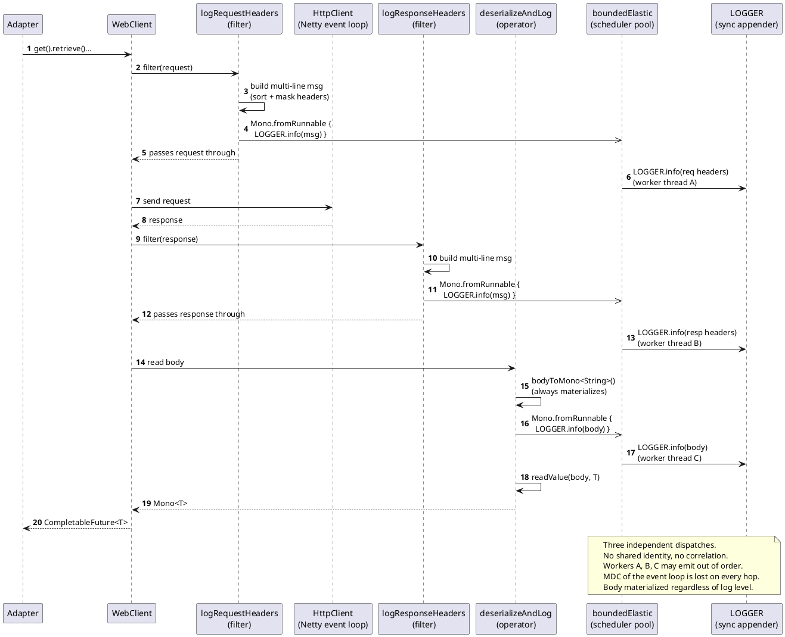
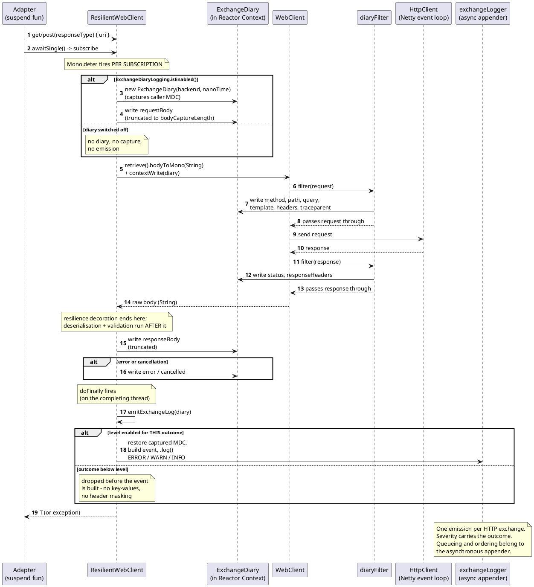

# Logging Guide: Reactive WebClient Adapters

> **Ownership & baseline.** Maintained by **Dirk Haase**. Verified against the code at commit `589d3890` (2026-07-30)
> Where this text and the code disagree, the code
> wins.

> **Which sections describe today.** Only §0 and §1. §4–§8 described the module's own exchange diary, which
> was **replaced by `legatium-webclient-logging` on 2026-09-18** (ticket 30) — §0 says what changed and where
> the current configuration is documented. §2 and §3 describe the **ORIGINAL** implementation and were history
> already: their code samples are quoted from the pre-refactor codebase and are not expected to match anything
> in the tree — the classes they name (`DefaultWebClientConfigurer`, `InvolvedPartyAPIReactiveAdapter`,
> `AsyncLogDispatcher`) are gone on purpose, and so are `ExchangeDiaryLogging` and `ExchangeDiary` now.

This guide describes how outbound HTTP logging is structured in the reactive
adapter layer. It is intended for developers who are new to the codebase or who
want to understand the rationale behind the current design.

The guide is organized as a narrative: it walks through the original
implementation, points out where it falls short, presents the new design that
replaces it, and is honest about the trade-offs the new design carries.

---

## 0. Superseded — the diary was replaced by legatium (2026-09-18)

> **Read this before anything below.** As of ticket 30
> (the ticket that introduced it in the origin project, dhaase/tool-box) the design in §4–§8
> is **no longer in the tree**. `ExchangeDiaryLogging.kt` and `ExchangeDiary` were deleted; `ResilientWebClient`
> creates no diary and captures no body; `ResilientWebClientFactory` attaches no filter. (Since 2026-10-21
> `ResilientWebClient` takes an MDC snapshot again, for its OWN transport lines only - the error, cancellation
> and closing lines, written on the event loop under the caller's keys; see `webclient-config-guide.md` §4.1.
> The exchange event does not use it.)
> The exchange event is written by the library
> [`legatium-webclient-logging`](https://github.com/Inqudium/legatium) (1.2.1), whose auto-configuration hangs
> its filter on Boot's `WebClient.Builder` bean — the bean the factory clones per backend since ticket 29.
>
> **What the library does that the diary did**, in the diary's own terms: one event per exchange (§6.1) on the
> logger `adapter-http-exchange`; structured `adapter_*` fields (§6.2), fourteen of them, mapped by the
> library's own component template; ordering by construction (§6.3); the caller's context restored around
> the emission (§6.4) — from the **Reactor Context** through registered `ThreadLocalAccessor`s (legatium
> ADR-0010), not from an MDC snapshot (§4.4); one level check before any assembly (§6.5); a fail-open guard
> with a meter instead of a swallowed exception (§6.6, §6.8); and body capture bounded by its own
> `max-body-bytes` (16 KB, `on-failure`) instead of by `maxInMemorySize` (§4.6).
>
> **What changed in meaning.** A 4xx answer is `rejected` with its status (INFO; WARN for 401, 403, 408 and 429
> — legatium ADR-0012, since 1.2.0), not a `failure` at INFO (§4.7); a
> 5xx is WARN, not ERROR; a TimeLimiter timeout and a caller's cancel are both `cancelled`; a breaker
> short-circuit or a full bulkhead produces **no** event, because no exchange happened — those verdicts stay on
> `ResilientWebClient`'s transport lines, which carry `adapter_name` and `adapter_url_template` under the
> library's own field names (`AdapterLogFields.kt` and the module's ELK template are gone with the diary;
> `adapter_target_name` is written by nothing any more). The backend name is `adapter_name` on the event, set through the
> request attribute `ClientRequestLoggingFilter.ADAPTER_NAME_ATTRIBUTE`; since 1.2.0 the message of a named
> client carries it in place of the URL (`Adapter http exchange GET involved-party -> 200 [...]`, ADR-0009
> amended). The level of `adapter-http-exchange` is a **filter** (§4.8's "one switch" is gone: WARN keeps the
> failures instead of switching the feature off).
>
> **Why.** The diary was the module-local generalisation the library became; keeping both meant a
> parallel implementation of the same filter, masking, fingerprint and `traceparent` parser (§4.7), maintained
> in one place and copied into another. The library carries them for the RestClient twin as well, with tests
> that pin the twins in lockstep.
>
> §1 still describes the adapter layer as it is. §2–§3 were history already. §4–§8 are now history too: the
> reasoning in them — why one event, why structured fields, why the emission must not be queued, why the bound
> on a body must be a parameter — is what the library implements, and it is kept here as the record of how
> the requirements were arrived at. Where the text below says "is", read "was, until 2026-09-18". The current
> configuration is in [`webclient-config-guide.md`](webclient-config-guide.md) §4.1; the queries in
> the origin project's Kibana runbook (`web-client/docs/runbooks/operation/ops-kibana-queries-web-client.md` in dhaase/tool-box, not ported).

---

## 1. Context and Scope

### 1.1 What the adapter layer does

The reactive adapter layer is a set of Spring components that issue outbound
HTTP calls to a local sidecar process. The sidecar in turn routes requests to
backend systems. Each adapter targets one logical upstream (Involved Party,
Product Agreement, Access Profile) and exposes a Kotlin interface of `suspend`
functions to the calling service.

Under the hood, each adapter uses Spring `WebClient` and Reactor Netty for the
actual HTTP I/O (Reactor Netty is the default engine; `app.webclient.engine`
can put a backend on the JDK client, Jetty or Apache HttpClient 5 instead -
[configuration guide](webclient-config-guide.md) §1.6), reached through a
`ResilientWebClient` that applies the
Resilience4j primitives as reactive OPERATORS —
`CircuitBreaker( TimeLimiter( Bulkhead( call ) ) )` — rather than as
annotations. The coroutine boundary is a single `awaitSingle()` at the adapter.

> **Note.** The original implementation described in §2 returned
> `CompletableFuture<T>` and used the `@CircuitBreaker` / `@Bulkhead` /
> `@TimeLimiter` annotations; §2 and §3 are written in those terms because that
> is what they document.

### 1.2 The loopback constraint

All WebClient calls go to the sidecar over the loopback interface
(`localhost`). The TCP handshake is sub-millisecond, the network never
partitions, and bandwidth is effectively unbounded. The only variable in
the request lifecycle is the time the sidecar (and the system behind it)
takes to produce a response.

This affects logging in two ways:

- Per-request HTTP latency is dominated by the backend, so request rates can
  be high even when individual requests are slow.
- Blocking I/O on the Netty event loop is *especially* costly: with only a
  handful of event loops serving hundreds of multiplexed requests, blocking
  on a synchronous log write stalls many concurrent flows at once.

### 1.3 The appender constraint — and its expiry

For most of this guide's history the constraint read: *Logback's
`AsyncAppender` is not available in the deployment environment; log calls go
directly to a synchronous appender that performs blocking I/O on the thread
that calls `LOGGER.info(...)`.* That single sentence is what shaped the whole
design — the application had to provide the asynchrony itself, because the
logging library would not.

**That constraint no longer holds.** The deployment runs
`SequencingAsyncAppender` (module `logback-kafka-appender`), a drop-in
replacement for Logback's `AsyncAppender` that queues events and hands them to
a Kafka appender on its own worker. The application-side queue that existed to
compensate has therefore been deleted; §4.3 records what it was and why it
went. The rest of the design — one event per exchange, the diary, MDC
restoration, level resolution before the event is built — is unaffected,
because none of it followed from this constraint.

What did NOT change is the reason the design cares about the calling thread at
all: emission happens on a Netty event loop, and the appender's queue offer is
where any remaining cost sits. The constraint moved one layer down; it did not
disappear.

---

## 2. The Original Implementation

### 2.1 Architecture overview

The original logging worked at three points in the WebClient lifecycle:

1. **Request headers** were logged by a `WebClient` filter
   (`logRequestHeaders`).
2. **Response headers** were logged by another `WebClient` filter
   (`logResponseHeaders`).
3. **Response bodies** were logged inside a custom `bodyToMono`-based
   extension (`deserializeAndLog`) that materialized the body as a String,
   logged it, and then deserialized to the target type.
4. **Request bodies** (only for `POST`/`PUT`/`PATCH`) were logged by a
   separate extension (`logRequestBody`) chained on the body publisher
   inside `.body(...)`.

Each of these produced a separate log event. A single HTTP exchange therefore
generated three or four lines in the log file.

### 2.2 The filter chain

Two filters were registered in `DefaultWebClientConfigurer`:

```kotlin
webClientBuilder
  .baseUrl(baseUrl)
  .clientConnector(ReactorClientHttpConnector(httpClient))
  .defaultRequest { it.attribute(ADAPTER_NAME_ATTRIBUTE, adapterName) }
  .filter(logRequestHeaders())
  .filter(logResponseHeaders())
  .filter(rejectUnexpected2xxFilter(acceptedSuccessStatuses))
  ...
```

`logRequestHeaders` ran when the request was outbound and produced a
multi-line log message like:

```
>> GET /accounts
>> accept: application/json,application/problem+json
>> x-ing-accesstoken: <secret>
>> ...
```

`logResponseHeaders` did the analogous thing for responses, with `<<` instead
of `>>`. Sensitive headers (`X-Access-Token`, `Authorization`, `Cookie`,
`Set-Cookie`) were masked with `<secret>`.

### 2.3 The body logging path

Response body logging was done inside an extension on
`WebClient.ResponseSpec`:

```kotlin
inline fun <reified T : Any> WebClient.ResponseSpec.deserializeAndLog(
  objectMapper: ObjectMapper,
  adapterName: String
): Mono<T> =
  this
    .bodyToMono<String>()
    .doOnNext { body ->
      val truncated =
        if (body.length > MAX_BODY_LOG_LENGTH) {
          body.take(MAX_BODY_LOG_LENGTH) + "... (${body.length} chars total)"
        } else {
          body
        }
      Mono.fromRunnable<Void> {
        ResponseBodyLogger.LOGGER.info("<< [{}] body: {}", adapterName, truncated)
      }
        .subscribeOn(ResponseBodyLogger.LOG_SCHEDULER)
        .subscribe()
    }
    .map { objectMapper.readValue(it, T::class.java) }
```

Two things are happening here. First, the entire response body is read into
a `String`, even if logging is going to be skipped. Second, the actual log
call is dispatched onto `Schedulers.boundedElastic()` via a `Mono.fromRunnable`
so the Netty event loop is not blocked by the synchronous appender write.

Request body logging followed the same pattern: an extension on the body
publisher that serialized the DTO with the `ObjectMapper`, then dispatched
the log call via Reactor.

### 2.4 The Reactor dispatch trick

The header filters used the same dispatch pattern:

```kotlin
fun logRequestHeaders(
  maskSensitiveHeader: (Pair<String, List<String>>) -> String = this::maskSensitiveHeader
): ExchangeFilterFunction =
  ExchangeFilterFunction.ofRequestProcessor { request ->
    val msg = buildRequestLogMessage(request, maskSensitiveHeader)
    Mono.fromRunnable<Void> { LOGGER.info(msg) }
      .subscribeOn(LOG_SCHEDULER)
      .subscribe()
    Mono.just(request)
  }
```

The intent was clear: format the log message on the event loop (cheap string
manipulation), then dispatch the I/O-bound `LOGGER.info(...)` call onto a
worker thread pool so the event loop never blocks. `LOG_SCHEDULER` was
`Schedulers.boundedElastic()`, Reactor's standard worker pool for blocking
operations.

Sensitive headers were masked with a lowercase-key lookup against a `Set`:

```kotlin
private val SENSITIVE_HEADERS = setOf(
  "x-ing-accesstoken",
  "authorization",
  "cookie",
  "set-cookie"
)

private fun maskSensitiveHeader(header: Pair<String, List<String>>): String =
  when {
    header.first.lowercase() in SENSITIVE_HEADERS -> SECRET
    else -> header.second.joinToString(separator = ",")
  }
```

### 2.5 What a typical adapter looked like

A GET adapter combined everything:

```kotlin
override fun findFutureAccounts(accountIds: List<AccountNumberValue>): CompletableFuture<PageAccountsDTO> =
  webClient
    .get()
    .uri { uriBuilder -> uriBuilder.path("/accounts").queryParam("ids", *ids).build() }
    .retrieve()
    .deserializeAndLog<PageAccountsDTO>(objectMapper, ACCOUNTS)
    .timeout(totalTimeout)
    .toFuture()
    .nonNull(adapterName = ACCOUNTS)
```

A POST adapter additionally chained `logRequestBody` inside `.body(...)`:

```kotlin
.body(
  Mono.just(payload).logRequestBody(objectMapper, BROKERAGE),
  PayloadDTO::class.java
)
```

The adapter name was repeated three times per method: in the `@TimeLimiter`
annotation, in the body-logging extension, and in the `nonNull` call. The
constant lived in a companion object on the adapter spec interface.

---

## 3. Weaknesses of the Original Implementation

The implementation worked — calls produced log entries, sensitive headers were
masked, the event loop was not directly blocked. But on closer inspection it
had a number of weaknesses that ranged from performance hotspots to outright
bugs.

### 3.1 Allocation overhead per log line

Each `LOGGER.info(...)` call went through a Reactor wrapper:

```kotlin
Mono.fromRunnable<Void> { LOGGER.info(msg) }
  .subscribeOn(LOG_SCHEDULER)
  .subscribe()
```

This allocates:

- A `MonoRunnable` instance wrapping the lambda.
- A `MonoSubscribeOn` wrapper around that.
- A `Subscription` for the subscribe call.
- A scheduling artifact when the work is handed to `boundedElastic`.

For a typical HTTP exchange (request headers + response headers + response
body = three log calls), this is several wrappers per request. At a few
hundred requests per second, the allocation rate adds up — and we just spent
all this machinery to avoid blocking on a single `LOGGER.info` call.

### 3.2 Lost ordering

`Schedulers.boundedElastic()` is a multi-threaded pool. Two log tasks
submitted in close succession can land on different worker threads and
complete in either order. The convention "request headers come before
response headers" — implicit in the `>>`/`<<` prefix scheme — was not
actually guaranteed.

Under sustained load, log lines from the same request could appear
interleaved with lines from other concurrent requests in arbitrary order.
The only way to reconstruct the sequence was by timestamp, and the
timestamps were generated *at log-write time* on the worker thread, not
at log-call time on the event loop.

### 3.3 No MDC propagation

If a trace ID or any other context value was set in `MDC` on the Netty
event loop, it was lost the moment the log task hopped to a
`boundedElastic` worker. Each `boundedElastic` thread has its own MDC,
and Reactor's scheduler does not propagate it.

In practice this meant: even if the rest of the application was carefully
maintaining trace context, the most diagnostically important logs (HTTP
request/response details) lacked that context. The `addKeyValue` pattern
common elsewhere in the codebase produced empty values when emitted
through the dispatcher path.

### 3.4 Javadoc/code discrepancy

The Javadoc on both logging files made the following claim:

> A DEBUG-level guard ensures zero overhead in production when DEBUG is
> not active.

The code did not match. There was no `isDebugEnabled` guard, and the log
level was `INFO`, not `DEBUG`. Every call did the full message-building
work — header iteration, sorting, sensitive masking, body materialization
— regardless of whether anyone would ever read the result.

The intent (skip work when logging is disabled) was sound, but the
implementation never delivered it.

### 3.5 Always-on body materialization

`deserializeAndLog` called `bodyToMono<String>()`, which always reads the
entire response body into a `String`, regardless of log level. For a
1 MB response that meant a 1 MB `String` allocation, full UTF-8 decode,
and *then* a second pass through Jackson to deserialize from the `String`
to the target type — versus the streaming `bodyToMono(T::class.java)`
alternative that would have decoded from the byte buffer directly.

The cost of this double-pass was paid by every call, including ones where
logging produced no output.

### 3.6 Multi-line log format

Log aggregators (Loki, Elasticsearch with default ingest, Splunk) treat
newlines as event boundaries unless explicitly configured otherwise.
The `>>` and `<<` prefixed multi-line messages therefore appeared as
many separate events in the aggregator, with the second through Nth
lines lacking the timestamp and level fields of the first.

Multi-line parsing rules can be added, but every team operating the
aggregator must know about the convention. A single-line structured
record is far simpler.

### 3.7 Request and response not correlated

Request headers and response headers were emitted as two distinct events
by two distinct filters. There was no correlation ID, no shared identifier,
no temporal anchor. Pairing a request with its response under concurrent
load required reading the timestamps and the URL and hoping there was no
ambiguity.

For a system that multiplexes hundreds of concurrent requests over the
same connection pool, this was a real diagnostic gap.

### 3.8 No duration measurement

Nowhere in the log output did the elapsed time of an HTTP call appear.
For a system in which response time is the single most important runtime
property (it determines whether timeouts trip), this was a surprising
omission. Performance debugging required either inspecting external
metrics or instrumenting the calls separately.

### 3.9 Allocation hotspots

Several smaller allocations added up:

- `header.first.lowercase()` allocated a new `String` per sensitive-header
  check. For ~15 headers per request and 200 RPS, that is 3000
  String allocations per second just for case-folding.
- `HttpHeaders.sorted()` allocated a list of `Pair` objects per request,
  sorted them, and returned a new collection — purely so headers appeared
  alphabetically in the log file. Aggregators sort by query when needed.
- `body.take(MAX_BODY_LOG_LENGTH)` always allocated a new substring even
  when the body was within the limit (technically `take` returns the
  original string in that case, but the `if/else` branch was evaluated
  on every body).

### 3.10 Subscribe-without-error-handler

The dispatch pattern called `.subscribe()` with no arguments. If the
logger itself threw — full disk, locked file, misconfigured appender —
the exception would surface in Reactor's `Operators.onErrorDropped`
hook, which by default logs a warning to a separate logger. In a
locked-file scenario, that warning attempt would also fail, producing
an error cascade.

### 3.11 The InvolvedParty timeout mismatch (related)

Not strictly a logging issue, but worth noting because it shares the
pattern: the timeout configuration in `InvolvedPartyAPIReactiveAdapter`
derives the WebClient's response timeout and `Mono.timeout` budget from
one Resilience4J TimeLimiter name (`INVOLVED_PARTY_BY_UUID`), but the
second method on the same adapter uses a different TimeLimiter
(`INVOLVED_PARTY_INTERNAL_IDENTIFIER`) for its `@TimeLimiter` annotation.
The two layers can disagree, breaking the four-layer timeout invariant.
This is fixed independently of the logging refactor.

---

## 4. The New Design

### 4.1 Constraints and goals

The design takes these constraints as given:

- The Netty event loop must not block on I/O of any kind, logging included.
- The application is on Java 21 with virtual threads available (per
  ADR-008), but Logback in this version pins virtual threads inside
  its synchronized appender lock — virtual threads do not help the
  logging path.
- Buffering log events is the log pipeline's job. The host's appender is
  asynchronous (§1.3), so anything the application queues itself is queued
  twice.

And sets these goals:

- Produce **one log event per HTTP exchange**, structured, single line,
  with all relevant fields (request, response, status, duration, bodies).
- Restore **MDC** on the thread that performs the log write — which is a
  Netty event loop and carries none of the caller's context.
- Give the event a **severity that matches the outcome**, so failures and
  cancellations are findable among the successful calls.
- Resolve the level **before** the event is built, so a disabled level costs
  neither the key-value assembly nor the header masking.
- Make the whole path switchable at **one** place, and make that switch
  honest about being a switch rather than a filter.

### 4.2 The two-layer architecture

The design has two layers and one cross-cutting piece of state.

```
┌──────────────────────────────────────────────────────────────┐
│ Capture layer                                                │
│   The call chain executes; the diary filter and the body     │
│   capture in ResilientWebClient populate an ExchangeDiary     │
│   placed into the Reactor Context.                           │
│   At chain termination, doFinally emits it.                  │
└──────────────────────────────────────────────────────────────┘
                              │
                              ▼
┌──────────────────────────────────────────────────────────────┐
│ Emission layer                                               │
│   Level resolved from the outcome; below-level events are    │
│   dropped before anything is built. SLF4J 2.x fluent API     │
│   builds the structured event under the caller's MDC.        │
│   Logback's ASYNCHRONOUS appender takes it from there.       │
└──────────────────────────────────────────────────────────────┘
```

The **diary** is a per-exchange mutable container, created per subscription in
`ResilientWebClient.execute` and propagated to the filter through the Reactor
Context. It lets information collected at different points in the reactive
pipeline (request line and headers from the filter, request body from the
serialisation step, response body from the raw-body mono, the resilience
verdict from `doOnError`/`doOnCancel`) flow to a single emission point at the
end of the chain.

### 4.3 The dispatch layer that was deleted

There used to be a layer between capture and emission: `AsyncLogDispatcher`,
a singleton around a `ThreadPoolExecutor` with one platform thread, a bounded
queue (4096 entries, later derived from a memory budget), a non-throwing
`RejectedExecutionHandler` that counted drops, and a self-report that named the
count on the next surviving task. It existed for exactly one reason — the
constraint in §1.3 — and it is **gone**.

**Why it went.** The deployment's appender is asynchronous. A queue in front of
an asynchronous appender does not add asynchrony; it adds a second bounded,
drop-on-overflow stage below the one that already exists, with its own capacity
to size, its own drop counter to monitor, and its own lifecycle to shut down.
Two queues in series also make loss harder to reason about, not easier: an
event can now be dropped in two places for two different reasons, and only one
of them was visible in the application's own metrics.

**What that cost, honestly.** Three properties of the deleted layer are not
free to give up, and it is worth naming them rather than pretending the removal
was pure gain:

- *Ordering* was guaranteed by a single worker draining a FIFO queue. It is now
  guaranteed by the appender's queue instead — `SequencingAsyncAppender` is
  likewise single-worker — so the property survives, but it is no longer this
  module's to guarantee.
- *The drop counter* was a Micrometer gauge this module owned
  (`lap.webclient.logger.dropped`). It is gone; see `metrics.md` §1 for what
  answers the same question now.
- *The event-loop hand-off* was a `queue.offer` that could never block. Emission
  is now synchronous on the completing thread, so what the event loop pays is
  whatever the appender's own offer costs. For an asynchronous appender that is
  a bounded-queue insert — the same operation, one layer down. For a
  *synchronous* appender it would be the full write, which is why §1.3 matters
  and why this design would have to change again if the deployment's appender
  ever changed back.

**What replaces the self-reporting.** `SequencingAsyncAppender` stamps every
event with a monotonic sequence number *before* the queue's discard check, so
events lost to a full queue leave a numbered gap the log backend can detect.
That is strictly more than the old counter saw: it also covers losses further
down the pipeline, past the point where this application's queue ended.

### 4.4 MDC propagation: `ExchangeDiaryLogging.wrap`

Emission runs in `doFinally` on a Netty event loop, which carries no MDC of its
own — the caller's trace context lives on the thread that started the call. The
diary therefore snapshots the MDC at construction (`capturedMdc`) and the
emission restores it around the log call:

```kotlin
// ExchangeDiaryLogging.kt
private fun wrap(captured: Map<String, String>?, task: Runnable) {
    val context = captured ?: emptyMap()
    val previous = MDC.getCopyOfContextMap()
    try {
        if (context.isEmpty()) MDC.clear() else MDC.setContextMap(context)
        task.run()
    } catch (e: InterruptedException) {
        Thread.currentThread().interrupt()
        logger.debug("Interrupted while logging an exchange; the event is dropped", e)
    } catch (e: Exception) {
        logger.error("Exception while calling MDC and logging exchange: $e", e)
    } finally {
        if (previous != null) MDC.setContextMap(previous) else MDC.clear()
    }
}
```

The semantics:

- The MDC is snapshotted when the `ExchangeDiary` is constructed — on the
  thread that subscribes, i.e. the caller's.
- It is installed for the duration of the log call and the previous map is
  reinstated afterwards, so the event loop does not carry a request's context
  into the next request it serves. **This matters more than it did on a
  dedicated worker:** the thread that emits is a thread that also does real
  work.
- What the event actually shows is not the raw snapshot but an overlay
  (`overlayTrace`): the call's OWN client span, parsed from the outgoing W3C
  `traceparent`, wins over the caller's context when present, so a
  context-less caller — a scheduled probe, say — still logs the trace the
  outbound call itself created.

Two catch clauses, not one. A failing log task must not take down the exchange
it describes, so `Exception` is caught and reported on this module's own logger
rather than the exchange logger. `InterruptedException` is pulled out ahead of
it and re-raised as a flag: an asynchronous appender blocks interruptibly when
its queue is full, so this path *can* be interrupted, and swallowing a shutdown
signal on a request-serving thread would leave whoever sent it waiting. `Error`
is deliberately not caught — an `OutOfMemoryError` says something about the JVM,
not about this task.

### 4.5 The diary pattern

`ExchangeDiary` is a per-request mutable record that accumulates
information about a single HTTP exchange. The data arrives at
different points in the reactive pipeline:

- The filter sees the `ClientRequest` and `ClientResponse`.
- The request-body operator sees the serialized request payload.
- The response-body operator sees the raw response payload.

Rather than emit a log event at each point, all of them write into the same
diary instance. A single emission at the end of the chain produces *one*
structured log event with everything in it.

```kotlin
// ExchangeDiaryLogging.kt
class ExchangeDiary(
    val backendName: String,
    private val nanoTime: () -> Long = System::nanoTime,
) {
    val startNanos: Long = nanoTime()
    val capturedMdc: Map<String, String>? = MDC.getCopyOfContextMap()

    @Volatile var method: HttpMethod? = null
    @Volatile var path: String? = null
    @Volatile var pathTemplate: String? = null   // low-cardinality, for aggregation
    @Volatile var query: String? = null
    @Volatile var requestHeaders: HttpHeaders? = null
    @Volatile var requestBody: String? = null
    @Volatile var status: Int? = null
    @Volatile var responseHeaders: HttpHeaders? = null
    @Volatile var responseBody: String? = null
    @Volatile var callTraceId: String? = null    // this call's OWN client span
    @Volatile var callSpanId: String? = null
    @Volatile var error: Throwable? = null
    @Volatile var cancelled: Boolean = false

    fun durationMillis() = TimeUnit.NANOSECONDS.toMillis(nanoTime() - startNanos)

    companion object {
        val KEY: Class<ExchangeDiary> = ExchangeDiary::class.java
    }
}
```

Three details are load-bearing and were not in the first version:

- **`@Volatile` on every field.** The writes happen on whichever thread the
  operator ran on; `doFinally` and the read at emission can fire on another.
  Without the happens-before guarantee the emission could see a half-populated
  record.
- **`nanoTime` is injected.** Time is a dependency, not ambient state, so a
  test can assert an exact duration instead of observing one. The same source
  is passed in by `ResilientWebClient`, which also measures the attempt itself
  — one clock, so the error log and the diary event cannot disagree.
- **`cancelled`.** A torn-down exchange bypasses `doOnError` entirely; without
  this flag it would log as "incomplete" — no status, no error — and read like
  a silent loss.

The diary is propagated through the Reactor Context, written per SUBSCRIPTION
rather than per assembly:

```kotlin
// ResilientWebClient.execute
val exchange = Mono.defer {
    val startNanos = nanoTime()
    val elapsedMillis = { TimeUnit.NANOSECONDS.toMillis(nanoTime() - startNanos) }
    val diary = if (ExchangeDiaryLogging.isEnabled()) ExchangeDiary(backendName, nanoTime) else null

    var rawMono = spec.retrieve().bodyToMono(String::class.java)
    if (diary != null) rawMono = rawMono.contextWrite { it.put(ExchangeDiary.KEY, diary) }

    resilience.decorate(backendName, rawMono)
        .map { rawBody -> /* capture body, deserialise, validate */ }
        .doOnCancel { doOnCancel(diary, responseType, elapsedMillis) }
        .doOnError { error -> doOnError(responseType, diary, error, elapsedMillis) }
        .doFinally { diary?.let { ExchangeDiaryLogging.emitExchangeLog(it) } }
}
return exchange.contextCapture()
```

Two orderings matter here. `contextWrite` propagates *upstream* (from
subscriber toward publisher), so it sits directly on the mono whose filter has
to read the diary. And the `Mono.defer` is what makes every mutable thing
per-subscription: a caller who subscribes twice — a `retry()` on the returned
mono, say — gets two diaries, two clocks and two emissions rather than one
shared, half-overwritten record.

### 4.6 Body capture

Both bodies are captured inside `ResilientWebClient`, where they already exist
as strings — the request body because this module serialises it itself, the
response body because the source mono deliberately produces raw `String` and
only deserialises *after* the resilience decoration:

```kotlin
// request side, in execute(): the body was serialised once, in post()
if (diary != null && requestBody != null) {
    diary.requestBody = ExchangeDiaryLogging.smartTruncate(requestBody, bodyCaptureLength)
}

// response side, in the map that also deserialises
.map { rawBody ->
    if (diary != null) diary.responseBody = ExchangeDiaryLogging.smartTruncate(rawBody, bodyCaptureLength)
    validate(objectMapper.readValue(rawBody, responseType))
}
```

Truncation happens at *capture* time, not at *emit* time, to bound the heap
footprint:

```kotlin
fun smartTruncate(body: String, maxLength: Int): String {
    if (body.length <= maxLength) return body
    val keep = maxLength / 2
    val omitted = body.length - 2 * keep
    return body.take(keep) + "... ($omitted chars omitted) ..." + body.takeLast(keep)
}
```

For JSON payloads, head-and-tail truncation is more diagnostically useful than
head-only truncation: the tail often carries the closing structure, error
indicators, or pagination metadata that the head omits.

**`maxLength` has no default, and that is the point.** It used to default to a
`MAX_BODY_CAPTURE_LENGTH` of 64 KB, which sat there long after the codec limit
had been set to 8 KB — two numbers for one quantity, drifting apart unnoticed,
with the request side (serialised by this module, never subject to the codec
limit) actually reaching the larger one. The bound is now derived:
`ResilientWebClientFactory` passes `maxInMemorySize` as `bodyCaptureLength`, on
the reasoning that copying more of a payload into a log line than the client is
willing to buffer of the payload itself makes no sense. One number, so the two
cannot drift again.

The request body is only attached to the event for `POST`/`PUT`/`PATCH`; for a
GET there is none to attach.

### 4.7 The combined filter

A single `ExchangeFilterFunction` records both request and response into
the diary:

```kotlin
fun diaryFilter(): ExchangeFilterFunction =
    ExchangeFilterFunction { request, next ->
        Mono.deferContextual { ctx ->
            val diary = ctx.getOrEmpty<ExchangeDiary>(KEY).orElse(null)
            if (diary != null) {
                diary.method = request.method()
                diary.path = request.url().path
                diary.query = request.url().query
                diary.pathTemplate = request.attribute(URI_TEMPLATE_ATTRIBUTE).orElse(null) as String?
                diary.requestHeaders = request.headers()
                parseTraceparent(request.headers())?.let { (traceId, spanId) ->
                    diary.callTraceId = traceId
                    diary.callSpanId = spanId
                }
            }
            next.exchange(request).doOnNext { response ->
                if (diary != null) {
                    diary.status = response.statusCode().value()
                    diary.responseHeaders = response.headers().asHttpHeaders()
                }
            }
        }
    }
```

The two filters from the old design are gone. With a single filter, the
request and response data live in the same diary instance, and there is
no ambiguity about which response belongs to which request — they share
an object identity.

Headers are stored raw and masked at EMIT time, not at capture time: masking
allocates, and an event that never reaches its level should not pay for it.
Sensitivity is decided by name PREFIX (`SENSITIVE_HEADER_PREFIXES`,
case-insensitive), so `X-Access-Token` and every `X-Access-Token*`
variant are covered by one entry; `maskHeaders` fast-paths to the plain
rendering when nothing is sensitive, which is the common case.

The emission step resolves severity first and only then builds the event:

```kotlin
fun emitExchangeLog(diary: ExchangeDiary) {
    val error = diary.error
    val (level, outcome) = when {
        isExpectedClientError(error) -> Level.INFO to "failure"   // a documented 4xx
        error != null                -> Level.ERROR to "failure"
        diary.cancelled              -> Level.WARN to "cancelled"
        else                         -> Level.INFO to "success"
    }
    if (!exchangeLogger.isEnabledForLevel(level)) return
    // ... build the event under the caller's MDC (see 4.4) and log it
}
```

Two things about that `when`:

- **A documented 4xx is not an outage.** The adapter contract declares certain
  4xx answers as normal outcomes — the 404 that says "this involved party does
  not exist" — so they drop to INFO. The structured fields do NOT change with
  the level: `adapter_outcome` stays `"failure"` and the status code is still
  there, because dashboards key off the fields, not off the severity.
- **The level decides before the event exists.** Below-level exchanges cost
  neither the key-value assembly nor the header masking — and that arithmetic
  now happens on a request-serving thread, which is what makes the ordering
  worth stating rather than assuming.

### 4.8 One switch, and it is a switch

The whole capture path is gated on one predicate:

```kotlin
fun isEnabled(): Boolean = exchangeLogger.isInfoEnabled
```

`ResilientWebClient` consults it once per subscription and simply does not
create a diary when it is false — no capture, no truncation, no emission.

The subtlety worth a paragraph: **this level is an on/off switch for the
feature, not a filter on its output.** The path emits at INFO, WARN and ERROR,
but the gate asks for the most verbose of those. Raising the logger to WARN in
the hope of "keeping only the failures" therefore keeps nothing: no diary is
created in the first place, and the ERROR events disappear along with the INFO
ones. That is counter-intuitive enough that it is stated in three places — the
KDoc of `isEnabled`, the comment above the level in `application.yml`, and
`LoggingLevelContractTest`, which binds the shipped level and asserts that
`isEnabled()` is actually true with it. The test exists because both sides were
once individually defensible while jointly switching the feature off, and
nothing noticed.

Throughput is deliberately NOT managed here. If successful exchanges are too
voluminous for the pipeline, that is a pipeline decision (sampling, an appender
queue, a retention policy), not a reason to blind the module to its own
failures.

### 4.9 What a migrated adapter looks like

The migration went one step further than the first version of this guide
described: adapters no longer assemble a chain at all. They describe a request
and await it, and every logging concern lives behind `ResilientWebClient`:

```kotlin
override suspend fun getByUuid(uuid: String): GetInvolvedPartyResponseV6DTO =
    client
        .get(GetInvolvedPartyResponseV6DTO::class.java) {
            it.uri("/v6/involved-parties/{uuid}", uuid)
        }.awaitSingle()
```

Nothing in that method mentions the diary, the context, the emission point, or
an operator order. The pieces the old example had to spell out — `contextWrite`
below the readers, `doFinally` above it, an `ExchangeDiary` constructed by
hand and named with a constant — are all inside `execute`, where they are
written once and tested once.

What the adapter still owns is the URI TEMPLATE, and it matters beyond
readability: `ResilientWebClient` stamps the endpoint's template onto the
request as an attribute, so the diary can record both the expanded path
(`adapter_url_path`, per-call detail) and the low-cardinality template
(`adapter_url_template`, for aggregation) — the same key Spring's own client
observation reads for its `uri` tag.

A POST adapter differs only in passing a body, which is serialised exactly once
and reused both on the wire and as the diary's request payload:

```kotlin
client.post(LookupInternalIdentifierResponseV5DTO::class.java, request) {
    it.uri { builder -> builder.path("/v5/involved-parties/lookup").build() }
        .contentType(MediaType.APPLICATION_JSON)
}.awaitSingle()
```

That serialisation sits deliberately OUTSIDE the diary's scope: a request that
could not be serialised never became an exchange — no method, no path, no
status, nothing on the wire — and emitting an event for it would put a phantom
call into a log whose consumers count real ones.

---

## 5. Sequence Diagrams: Data Flow Before and After

These two diagrams contrast how information flows through the logging path
in the original implementation and in the new design. The diagrams use
PlantUML syntax. They render in IntelliJ with the "PlantUML Integration"
plugin (no Graphviz needed for sequence diagrams), and in any Markdown
viewer that supports PlantUML code fences. For viewers without PlantUML
support, the code blocks remain readable as plain text. To publish the
rendered diagrams elsewhere (for example on GitHub, which does not render
PlantUML natively), export them via the PlantUML CLI or a proxy service
such as Kroki.

The diagrams focus on data flow rather than every Reactor operator. Minor
details (the Resilience4J annotations, the `rejectUnexpected2xxFilter`,
`Mono.timeout`, `nonNull`, `toFuture`) are omitted to keep the timeline
legible.

### 5.1 Original implementation

In the original implementation, each logging point produces an independent
event. The Reactor dispatch pattern hands each event off to a
`boundedElastic` worker thread; the workers emit to the logger in whatever
order they happen to be scheduled.



The diagnostic problem is visible in the diagram: three log calls reach
the logger from three different `boundedElastic` workers, with no shared
state and no ordering guarantee. The dashed `-)` arrows mark fire-and-forget
dispatches — the filter returns immediately, and the worker processes the
log task on its own schedule.

A read of the resulting log file does not let you reliably reconstruct
which response goes with which request under concurrent load: the only
clue is the request URL, which may or may not be unique.

### 5.2 New design

In the new design, all data points write into a single `ExchangeDiary`
instance that travels with the Reactor Context. A single emission at the
end of the chain produces one structured log event covering the whole
exchange.



Three structural differences compared with the previous diagram:

- **The Diary is a participant.** It is the integration point for
  information that becomes available at different operators in the chain
  — and the reason the diagram has fewer log-write arrows. All operators
  contribute to one record, not their own independent events.
- **The gate is at the top, not at the bottom.** The outer `alt` shows what
  `isEnabled()` really controls: not whether an event is written, but whether
  anything is captured at all. The inner `alt` is the per-event level check.
- **There is no dispatcher participant.** Emission runs on the thread that
  completed the exchange; the queue that used to sit here now lives in the
  appender (§4.3), which is also where ordering is guaranteed.

### 5.3 How to read the arrow styles

The two diagrams use a deliberate convention based on PlantUML's standard
arrow set:

- Solid arrow with closed arrowhead (`->`) is a synchronous call where
  the caller waits for the callee to return control.
- Dashed arrow with closed arrowhead (`-->`) is a return value or
  pass-through.
- Solid arrow with open arrowhead (`->>`) is a fire-and-forget dispatch:
  the caller hands off work but does not wait. The ORIGINAL design uses this
  when subscribing to a `Mono.fromRunnable`.

In the original design, three operators each fire-and-forget into
`boundedElastic`. The current design has no fire-and-forget arrow left: the
emission is an ordinary call on the completing thread, and the hand-off to a
worker happens inside the appender, below the boundary this diagram draws.

---

## 6. Strengths of the New Design

### 6.1 One event per exchange

A single HTTP call produces a single structured log entry. Correlating
request data with response data is trivial because they share a record.
Log volume is reduced by a factor of three to four compared with the
old multi-event scheme.

### 6.2 Structured fields

Every value is a named key-value pair, prefixed `adapter_`. A JSON encoder
serializes them directly as JSON properties; a pattern encoder can emit them
with `%kvp`. Aggregator queries like
`adapter_target_name:"apis-example-com-GET-v6-involved-parties" AND adapter_duration_ms:>500`
work out of the box, no regex parsing required — and grouping is done on
`adapter_url_template` rather than `adapter_url_path`, which is the whole
reason both are recorded. The full field list is in `metrics.md` §4.

### 6.3 Ordering preserved

The `>>`/`<<` ambiguity of the old design is gone by construction: there are no
separate request and response events whose order can flip, because there is
only one event. Ordering ACROSS exchanges is the appender's guarantee — its
queue is drained by a single worker — rather than this module's.

### 6.4 MDC propagation

Trace IDs and other context values set on the calling thread are present when
the event is written, even though the write happens on a Netty event loop that
never saw them: the diary snapshots the MDC at construction and `wrap` installs
it for the duration of the log call. Better than a plain restore, the event
prefers the call's OWN client span over the caller's context when the outgoing
request carried a `traceparent` — so a context-less caller still logs a usable
trace.

### 6.5 One event, one level check, no wasted work

An exchange whose level is disabled costs the level check and nothing else: no
key-value assembly, no header masking, no body copy. When the feature is off
entirely, the cost is one predicate per subscription and no diary at all. The
guard is real this time — the old Javadoc claimed one that the code did not
have.

### 6.6 Loss is visible where it happens

Log loss is not silent, but it is no longer this module's story to tell. The
asynchronous appender discards under queue pressure and stamps a monotonic
sequence number before it does, so a gap is detectable in the log backend
(§4.3). That covers strictly more than the old application-side counter did,
which could only see the losses at its own queue and was blind to everything
downstream.

### 6.7 Lower allocation rate

The Reactor `Mono.fromRunnable(...).subscribeOn(...).subscribe()` chain
allocated several wrapper objects per log call; the emission path now allocates
none of them. The per-header `String.lowercase()` allocation is gone (masking
is prefix-matched case-insensitively, and skipped entirely when no header is
sensitive). The per-request `HttpHeaders.sorted()` allocation is gone. Body
capture happens only when the diary exists, and masking only when the event
survives its level check.

### 6.8 No silent error path

The Reactor `.subscribe()` without error handler in the old code routed logger
exceptions into Reactor's global dropped-error hook, where they were nobody's.
`wrap` now catches them and reports them on this module's OWN logger — not on
the exchange logger, so a broken log event cannot masquerade as a broken
exchange — while an `InterruptedException` is re-raised as a flag rather than
swallowed, because on a request-serving thread that signal belongs to someone
else.

---

## 7. Weaknesses and Trade-offs of the New Design

The new design is better than the old one, but it is not free of
trade-offs. Future maintainers should know about these so they can make
informed changes rather than discovering them in production.

### 7.1 In-memory buffering means crash loss

The buffering moved into the appender, but it is still in memory: events sitting
in the appender's queue are lost on a JVM crash or `SIGKILL`. The trade is the
same as before, one layer down — and now at least it is a single, well-known
queue with a documented discard policy rather than two in series.

For compliance-sensitive logs, this pipe is not the right one. Such logs need a
durability mechanism the process cannot lose (file-backed queue, synchronous
write, external shipper with acknowledgement). The adapter's HTTP exchange logs
are not in that category.

### 7.2 The error path captures less than the success path

When an HTTP response is a 4xx or 5xx, Spring's `retrieve()` raises a
`WebClientResponseException` before the body-mapping step runs, so the capture
in `.map { ... }` never sees a body.

This one is now *mostly* handled rather than merely acknowledged: `doOnError`
recovers the error body from the exception (`responseBodyAsString`, which Spring
buffered on it) and truncates it into the diary, so a failed exchange usually
carries its response body after all. What remains uncovered is the case where
the failure produced no response at all — a transport error, a TimeLimiter
timeout, a circuit-breaker short-circuit — where there is genuinely nothing to
capture and the fields stay null.

### 7.3 Mutable state across reactive boundaries

`ExchangeDiary` is mutable. Reactor encourages immutable values flowing
through operators, and the diary breaks that convention deliberately:
it accumulates state across operators that the Reactor data model would
otherwise require to be threaded through as separate context values.

The mutability is safe in practice because the operators in question run
sequentially within a single reactive chain — there is no concurrent
write — and every field is `@Volatile`, so the emission on a different thread
sees a complete record rather than a partially published one. But it remains a
place where a careless refactor (introducing a `parallel()` operator, or
splitting the chain via `flatMap` in surprising ways) could break the
assumption silently. Code review and tests are the safety net.

### 7.4 Reactor Context propagation through Spring internals

The filter reads the diary out of the Reactor Context, which requires Spring to
propagate the outer context into the exchange it runs. A future Spring upgrade
that changes this could silently empty the diary: the event would still be
emitted, with null fields, and nothing would alert.

`ResilientWebClientIntegrationTest` asserts on populated diary events for both
GET and POST, including the trace-context path. Those tests are the canary;
they fail loudly if the assumption breaks.

### 7.5 Operator order is bug-prone — but it is written once

The order that matters — `contextWrite` below the readers, the capture inside
the decoration, `doOnError`/`doOnCancel`/`doFinally` outside it, everything
inside a `Mono.defer` — is subtle, and getting it wrong is silent: the diary
stays empty or the resilience verdict never reaches it.

The mitigation is structural rather than procedural: the chain lives in
`ResilientWebClient.execute` and nowhere else. Adapters cannot get it wrong
because they never write it (§4.9). What a reviewer has to check is one method,
not nine adapters — which is a different and much smaller problem than the one
the first version of this guide described.

### 7.6 The design now depends on a property of the deployment

Removing the application-side queue traded a piece of duplication for a
dependency: the design is correct **because** the deployment's appender is
asynchronous. Nothing in this module enforces that. Configure a synchronous
appender and emission blocks a Netty event loop on I/O — quietly, with no test
failing, because every test here uses an in-memory appender.

This is the trade-off to know before changing the logging configuration, and
the reason §1.3 states the premise as a premise rather than as background.

### 7.7 Loss is no longer attributable to this module

The old counter was JVM-global and could not tell which adapter's events were
dropped. The replacement is better in reach and worse in attribution: a
sequence gap proves that events were lost, not which ones. Reconstructing what
went missing means correlating with what did arrive.

For an exchange log this is acceptable — the surviving events carry the backend
name — but it is a genuine loss of precision compared with a counter this
module owned.

### 7.8 The appender remains the ultimate bottleneck

Buffering does not make writing faster; it only decides who waits. If the
appender's consumer cannot keep up with the emission rate, its queue fills and
its discard policy takes over — for `AsyncAppender` and its sequencing variant
that means INFO/DEBUG/TRACE events go first, at 80% queue occupancy by default.
Since successful exchanges are exactly the INFO events, a saturated pipeline
sheds the routine traffic first and keeps the failures. That is the right order,
but it is a policy of the appender, not a property this module can promise.

### 7.9 Logback synchronization vs. virtual threads

Logback's `OutputStreamAppender` uses `synchronized` internally for
appender-level thread safety. On JDK 21, a virtual thread entering a
synchronized region pins its carrier for the duration of the lock hold. The
emission path is not on a virtual thread today — it is a Netty event loop — but
the enqueue into the async appender does take that lock briefly, so a future
service layer on virtual threads that logs directly is where the pinning would
show up.

JEP 491 ("Synchronize Virtual Threads without Pinning") targets JDK 24+;
once that ships, this concern dissolves. For JDK 21 it is a coexistence
detail rather than a problem with the design itself.

### 7.10 More moving parts than direct `LOGGER.info()`

A developer reading the code for the first time has to understand:

- That `ExchangeDiary` is propagated via Reactor Context and mutated across
  operators.
- That `wrap` is the MDC-propagation primitive, and why the emission thread has
  no MDC of its own.
- That the level is resolved from the OUTCOME before the event is built.
- That `isEnabled()` is a feature switch, not a filter (§4.8).

Compared with the conceptual simplicity of `LOGGER.info(message)`, this is a
lot. The complexity is justified by the requirements (event loop not blocking,
one event per exchange, MDC propagated, severity carrying the outcome), but it
is real complexity — measurably less than it was, since the dispatcher, its
queue sizing, its lifecycle and its self-reporting are no longer part of what
has to be learned.

---

## 8. When This Design Should Be Revisited

The design assumes certain constraints. Several plausible future
changes would shift the trade-offs:

**If the deployment's appender becomes synchronous again.** This is the premise
the current shape rests on (§1.3, §7.6). Emission would then block a Netty
event loop on I/O, and an application-side hand-off would have to come back —
`AsyncLogDispatcher` is in git history and was deleted for a reason that would
no longer hold. Everything else (diary, filter, MDC restore, level resolution)
would stay as it is.

**If JDK 24+ ships with JEP 491.** Virtual threads no longer pin on
`synchronized`, so the appender's internal lock stops being a consideration for
any caller. Nothing in this design has to change; a service layer on virtual
threads simply stops needing the caveat in §7.9.

**If Micrometer Tracing is wired in the host.** It largely already is — the
client observation opens a CLIENT span and injects the W3C `traceparent`, which
the diary parses to log the call's own trace even for a context-less caller.
What would change is the MDC snapshot: with Micrometer Context Propagation
carrying the context across the reactive boundary, the manual capture in
`ExchangeDiary` could be dropped in favour of the automatic one. Worth doing
only once the host guarantees the bridge is present.

**If sequence gaps appear in the log backend.** That means the appender is
discarding: either its consumer (Kafka) is slower than the emission rate, or
the rate is higher than budgeted. Investigate the appender and its downstream
first. The application-side answer — emitting fewer events — is a last resort,
and the honest way to do it is sampling successful exchanges, not raising the
diary's level, which switches off the failures too (§4.8).

**If compliance requires zero log loss.** Neither this module nor an
in-memory-queued appender can guarantee that. A persistent queue (Chronicle
Queue, Aeron, an external broker with acknowledgement) would be required, and
the architecture would become: exchange → persistent queue → shipper → sink.

---

## 9. Appendix: Quick Reference for Existing-Code Archaeology

For developers reading the old code in git history:

| Old symbol | New equivalent | Notes |
| --- | --- | --- |
| `logRequestHeaders()` filter | Part of `diaryFilter()` | Combined request/response |
| `logResponseHeaders()` filter | Part of `diaryFilter()` | Combined request/response |
| `deserializeAndLog<T>(om, name)` | The `.map { ... }` in `ResilientWebClient.execute` | Capture + deserialise + validate, AFTER the resilience decoration |
| `logRequestBody(om, name)` | `diary.requestBody` set in `execute` | The body is serialised once in `post()` and reused |
| `Mono.fromRunnable { LOGGER.info(...) }.subscribeOn(...).subscribe()` | `ExchangeDiaryLogging.emitExchangeLog(diary)` | Synchronous; the appender does the queueing |
| `AsyncLogDispatcher.submit { ... }` | Removed | Deleted with the constraint that motivated it (§4.3) |
| `Runnable.withMdc()` | `ExchangeDiaryLogging.wrap(capturedMdc) { ... }` | Same capture/restore idea, no worker in between |
| `MAX_BODY_LOG_LENGTH = 32 KB` / `MAX_BODY_CAPTURE_LENGTH = 64 KB` | `bodyCaptureLength`, derived from `maxInMemorySize` | No default: the bound is a parameter so it cannot drift (§4.6) |
| `adapter.logger.dropped` gauge | Removed | Appender-side sequence gaps answer the same question (`metrics.md` §1) |
| `header.first.lowercase() in setOf(...)` | `SENSITIVE_HEADER_PREFIXES.any { startsWith(it, ignoreCase = true) }` | Prefix match, no per-header allocation, masking at emit time |
| `HttpHeaders.sorted()` extension | Removed | Aggregators sort; we don't need to |
| Multi-line `>>` / `<<` log lines | Single structured event with `addKeyValue(...)` | One event per HTTP exchange |
| `ADAPTER_NAME_ATTRIBUTE` on request | `ExchangeDiary.backendName` | Backend identity carried by diary; it is also the R4j instance name |
| Fixed DEBUG level for every event | Level from the outcome: ERROR / WARN / INFO | Severity is the signal (§4.7) |

---

## 10. Glossary

**Adapter**. A Spring component implementing one logical upstream API. Each
makes calls through a `ResilientWebClient` to the sidecar.

**Diary**. `ExchangeDiary`, the per-subscription mutable state container that
accumulates information for one HTTP exchange.

**Dispatcher**. `AsyncLogDispatcher`, the single-worker async queue that used to
offload synchronous Logback calls from the Netty event loop. **Removed** — see
§4.3. The term survives here only because it appears in git history and in
older revisions of this guide.

**Loopback / sidecar**. All outbound HTTP from the adapters targets a local
sidecar process. TCP latency to the sidecar is negligible; all observed
latency is sidecar plus its downstream backend.

**MDC**. Mapped Diagnostic Context. A per-thread map of key/value pairs
that Logback can emit with each log event. Used for trace IDs and request
metadata. Not automatically propagated across thread hops; the diary captures
it at construction and `ExchangeDiaryLogging.wrap` restores it around the log
call.

**Reactor Context**. A read-only key/value map associated with a Reactor
subscription. Used here to carry the `ExchangeDiary` from the adapter
into the filter and the body-capture operators. Propagates upstream,
not downstream — a subtlety that affects operator order in the chain.

**TimeLimiter**. A Resilience4J primitive that imposes a wall-clock timeout on
the decorated call — here as the reactive `TimeLimiterOperator`, one instance
per mesh endpoint. Its budget and the transport's response timeout are both
derived from the same per-endpoint mesh ladder (see `veredium-core/docs/mesh-timeout.md`), so they
cannot drift past each other.
